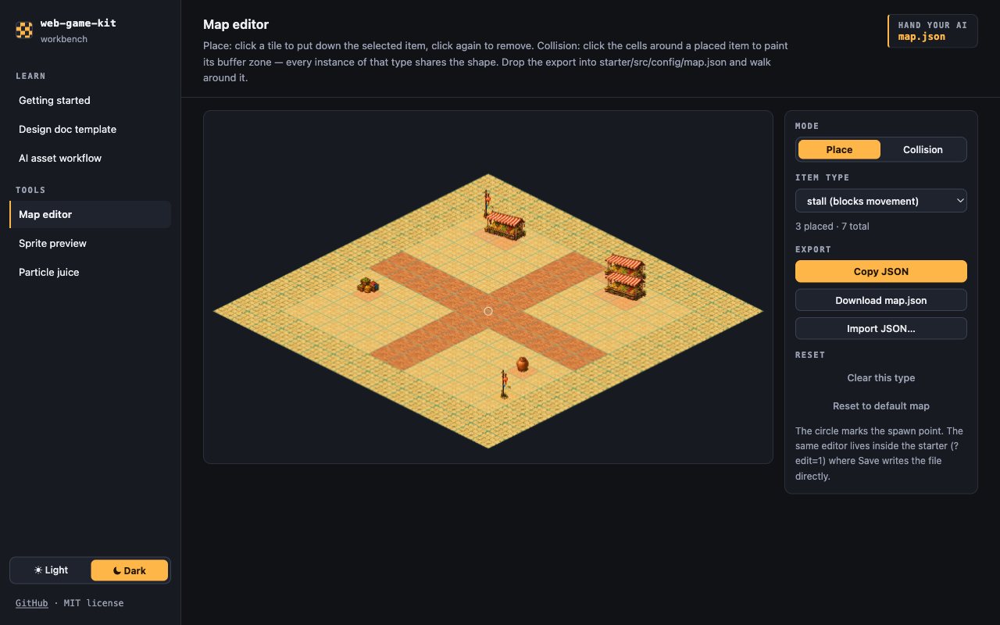
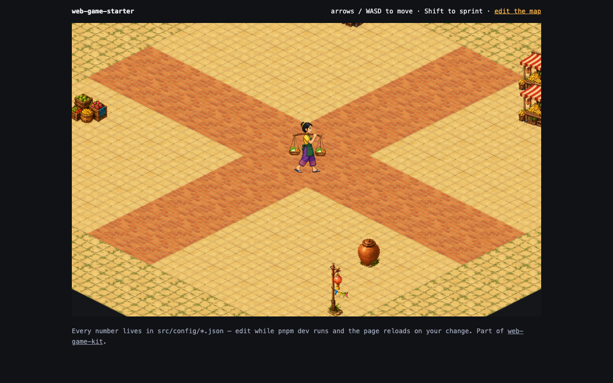
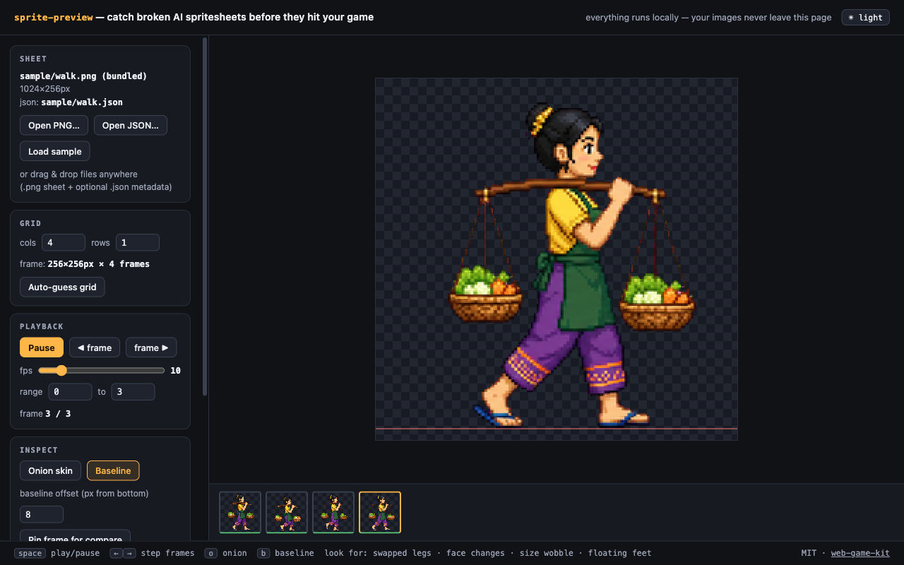
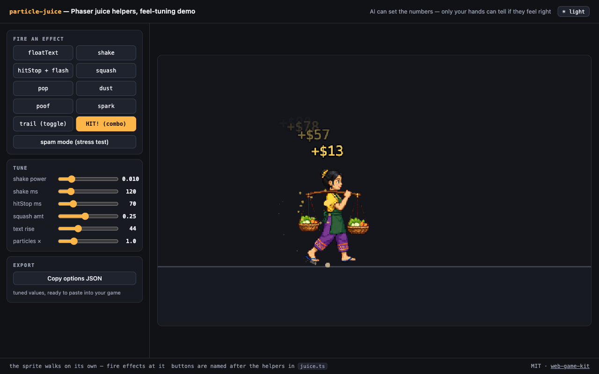

# web-game-kit

Tools and Claude Code skills for building web games with AI — extracted from
building [Taladtaek](https://taladtaek.com) ("market outbreak"), a 10-player
online survival game, and given away so your next game starts faster.

Everything here is small, self-contained, and usable in minutes.

<picture>
  <source media="(prefers-color-scheme: light)" srcset="docs/workbench-light.png">
  
</picture>

## What's inside

| | What it does |
|---|---|
| [`workbench/`](workbench/) | **start here** — one admin-style web app with a side menu that hosts everything below: guides, the map editor, sprite preview, and particle juice |
| [`starter/`](starter/) | React + Phaser isometric starter — walk around a small market scene, every number in JSON configs, with a built-in map editor (`?edit=1`) that writes placements back to `src/config/map.json` |
| [`tools/sprite-preview/`](tools/sprite-preview/) | one HTML file that catches AI spritesheet drift (swapped legs, size wobble, floating feet) before it hits your game |
| [`tools/particle-juice/`](tools/particle-juice/) | copy-paste juice helpers for Phaser 4 — floating text, screen shake, hit-stop, dust/poof/spark particles, plus a feel-tuning demo |
| [`tools/design-doc-template.md`](tools/design-doc-template.md) | the one-page design doc to fill in before you ask AI to write any code |
| [`skills/`](skills/) | Claude Code skills that let Claude hand image work to Codex: general image generation + game-ready asset pipeline (magenta-key transparency, spritesheet slicing) |

| walk around the starter | catch spritesheet drift | tune the juice |
|---|---|---|
|  |  |  |

## Quick start

**Try it online first: [kit.ntpon.com](https://kit.ntpon.com)** — the workbench, nothing to install.

```bash
git clone https://github.com/ntpon/web-game-kit
cd web-game-kit/workbench && pnpm install && pnpm dev   # all tools in one web app
cd ../starter && pnpm install && pnpm dev               # walkable demo → :5173
```

No-install option: open `tools/sprite-preview/index.html` and drag in `sample/walk.png`.

MIT — use anything here in your own games, commercial or not.
Made by [Nattapon Suetrong](https://ntpon.com).
