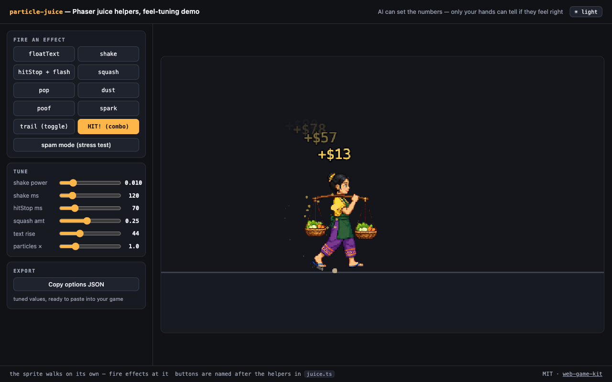

# particle-juice

**Tiny juice helpers for Phaser 4** (works on Phaser 3.60+ too).

Game engines ship a particle system; the web doesn't. This is the missing piece:
copy `juice.js` (or `juice.ts`) into your game and every hit, pickup and spawn
gets feedback — no image files, no dependencies. Particle textures are generated in code.

## Effects

| Call | Feel |
|---|---|
| `floatText(scene, x, y, '+$50')` | number/text rises and fades |
| `shake(scene, { intensity })` | camera shake on hit |
| `hitStop(scene, ms)` | freeze-frame so an impact lands |
| `flash(sprite)` | white damage blink |
| `squash(sprite)` | squash & stretch on pickup/landing |
| `pop(sprite)` | overshoot pop-in on spawn |
| `dust(scene, x, y)` | footstep dust puffs |
| `poof(scene, x, y)` | spawn/despawn smoke cloud |
| `spark(scene, x, y)` | pickup/critical spark burst |
| `trail(scene, target)` | dash/projectile trail — call `.stop()` when done |

Every effect cleans up after itself. Every option has a tuned default.

## Tune the feel (the human part)

AI can wire these calls into your game in one pass — but only your hands can tell
if 70 ms of hit-stop feels right. Open **`demo.html`** (serve the folder over http),
fire effects at a walking sprite, drag the sliders, then **Copy options JSON**
and paste the tuned values into your game.

MIT · part of web-game-kit · by [Nattapon Suetrong](https://ntpon.com)
