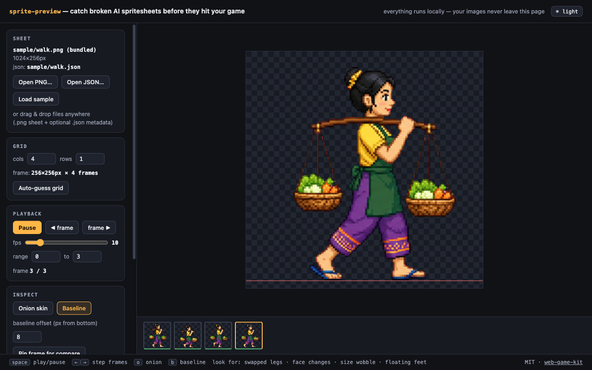

# sprite-preview

**Check AI-generated spritesheets before they hit your game.**

AI walk cycles look fine frame-by-frame — the drift (swapped legs, face changes,
size wobble, floating feet) only shows when the frames move. This page shows the movement.

One HTML file. No build, no install, no network — your images never leave the page.

## Use

1. Open `index.html` in any browser.
2. Drag in a spritesheet `.png` (plus an optional `.json` — gameasset `metadata.json`
   or a TexturePacker / Phaser atlas — to auto-configure the grid).
3. Press **space** to play. Adjust fps, step frames with **←/→**.

Try it now with the included `sample/walk.png` + `sample/walk.json`
(a real AI-generated walk cycle, drift included).

## Inspect tools

| Tool | Catches |
|---|---|
| Onion skin (`o`) | frame-to-frame drift — ghost of the previous frame overlaid |
| Baseline (`b`) | floating feet — red line at a fixed offset from the bottom |
| Pin + Compare view | side-by-side: a known-good frame vs. the suspect one |
| Frame stepping + filmstrip | the one bad frame in an otherwise fine cycle |
| Copy config JSON | grid/fps/range config, ready to paste into your game |

MIT · part of [web-game-kit](https://github.com/ntpon/web-game-kit)
